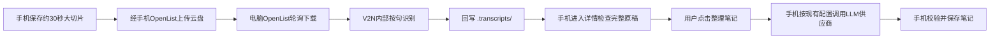

# Design

## Context

动机见 [proposal.md](proposal.md)。当前代码与本次确认的边界：

- `RecordingService` 已持久保存 16 kHz 单声道 PCM16 WAV，约 30 秒关闭一个文件，但同时通过 `SpeechSegmenter` 生成最长约 15 秒的识别段与预览，启动 `AsrClient`。远程分支应保留采集与大文件落盘，绕过整个手机识别分支，而不是仅隐藏设置。
- `AudioImporter` 已能解码并保存约 30 秒音频块，但还生成短识别段和调用 `AsrClient`。远程导入可复用解码／大块保存，跳过本地分句和推理。
- `SettingsScreen` 当前首先显示本地模型，随后显示 `CloudSettingsPanel`；`SettingsStore` 已提供本机密钥加密和 WebDAV 连接资料。
- `NotesRepository`、`NoteValidator`、`DetailScreen` 和 `WebDavSyncRepository` 当前提供手机供应商连接测试、提示词快照、工具回执、`NoteBatchEntity` 保存与同步。远程原稿映射为现有 `SegmentEntity` 后继续使用这条整理流程；V2N 回写的 Markdown 是原稿，不是最终笔记。
- 此前核对 Voice2Note 的提交 `c7e837c7563e95c224e021bb8000b9e0b4fb64e4`：[CLI](https://github.com/zhangtony239/Voice2Note/blob/c7e837c7563e95c224e021bb8000b9e0b4fb64e4/src/voice2note/cli.py) 自动执行 ASR 与 LLM 两阶段；[ASR](https://github.com/zhangtony239/Voice2Note/blob/c7e837c7563e95c224e021bb8000b9e0b4fb64e4/src/voice2note/asr.py) 已有按句切分和模型懒加载。新增电脑服务只复用识别函数，不运行 CLI 的完整流水线。
- 当前范围：电脑只做 ASR，其服务 `config.yaml` 只含识别及必需的服务／OpenList 配置，不含 LLM。手机在详情取回 `.transcripts/` 完整原稿，仍由现有「整理笔记」按钮直接调用手机配置的供应商；手机提示词、读图、保存和导出沿用原流程。

## Goals / Non-Goals

**Goals:**

- 分离音频上传、电脑识别、手机原稿回收和用户主动整理的状态，避免把「音频已经发出」误认为「笔记已完成」。
- 复用已有大切片、加密与手机 LLM 整理／保存／导出能力；只为电脑识别新增任务和原稿协议。
- 用最终清单和内容校验处理网盘延迟、半成品及重试，手机无需了解 V2N 内部的小语句。

**Non-Goals:**

- 首版不做电脑 LLM 或读图、逐句实时字幕、ASR 完成自动整理、双向资料恢复或自动删除网盘副本。
- 不用公开电脑 API 上传录音；不假定仅把地址改成 OpenList 就自动绕开隧道。
- 不在本仓库修改 Voice2Note，不在 propose 阶段修改 Android 代码。

## Decisions

### 1. 模式属于记录，设置只决定下一份记录

`SettingsStore` 新增全局识别模式和 ASR 连接版本；`LessonEntity` 增加识别模式，迁移默认 `local`。每份远程记录绑定独立 `session_id`，以及 ASR 后端和网盘连接版本。全局切换不迁移既有记录、不改变进行中的识别任务，也不改变手机的 LLM 配置或整理任务。

设置页顶部切换仅控制本地识别模型区与 ASR 后端连接区。`CloudSettingsPanel` 和系统提示词入口在两种模式下继续显示，保存的供应商预设、密钥、模型、读图设置与测试状态保持。ASR 测试只检查电脑识别与网盘链路，与手机 LLM 测试相互独立。

远程分支不能实例化 `AsrClient`，也不能让 `SpeechSegmenter` 产生手机识别文件。采集／解码依旧进行；完整 WAV 关闭后持久化封存事件，异步队列处理上传。补齐正常 30 秒换块时数据库 `sampleCount` 的最终更新，不能仅依赖每秒 checkpoint 或进程重启后的修复。

备选方案是按当前全局设置动态选择执行器；这会使中途切换改变一份记录的恢复方式，因此采用记录快照。

### 2. 同一网盘连接，独立音频队列和根目录

手机复用已有 WebDAV 地址／账号配置，远程连接区提示需要配置手机 OpenList。音频中转的授权来自该记录选择远程模式，不依赖笔记同步开关。共享的是连接资料，不是笔记同步任务、目录或生命周期开关。

约定双方配置的 WebDAV 根指向同一真实云盘文件夹，可各自使用不同的 OpenList 挂载名。`cloud_path` 固定为该根下 `RecNoteRemote/<session_id>`，不是任意 URL；电脑拼接自己配置的根。手机本地 OpenList 和电脑本地 OpenList 可各用 `http://127.0.0.1:5244/dav/<自己的挂载>`。

连接配置需要区分「地址／账号版本」与「笔记同步启用开关」，避免仅关闭笔记同步就暂停音频。地址／账号或后端 token 改变会暂停旧远程队列；旧记录明确提示恢复原配置并手动重试，不能套用新账号。

使用独立客户端职责扩展 WAV／JSON 的 MIME 类型、GET 和结果查询；现有 `WebDavClient.put` 按文件名选择 PDF／Markdown／JPEG 的逻辑不能直接用于音频。

[OpenList 官方说明](https://docs.openlist.team/guide/drivers/common.html) 区分本机代理、真实链接跳转和代理 URL。首版建议两端使用各自本机代理，避免笔记客户端的禁止重定向约定与下载 302 冲突；挂载存储和其代理 URL 仍要确认不再绕回公开电脑隧道。联调记录实际上传入口、下载入口及最终传输主机，不能凭架构图声称已绕开 cloudflared。

### 3. 云盘文件是音频与结果的数据通道

目录协议 v1，手机写音频清单，电脑写识别原稿：

```text
RecNoteRemote/<session_id>/
  audio/000001.wav
  audio/000002.wav
  manifest.json                  # 手机：滚动的已上传音频清单
  final.json                     # 手机：停止后不可变的全部音频清单
  .transcripts/
    000001.md                    # 电脑：一个大切片的完整原稿
    000002.md
    index.json                   # 电脑：块结果／错误与递增版本
    complete.json                # 电脑：整次识别完成，不触发 LLM
```

无需对每条语句建云盘文件。每个音频大切片完成上传后才更新同一个 `manifest.json`。不强制云盘支持原子重命名：JSON 必须可完整解析、任务匹配且版本不回退，数据文件必须通过大小和 SHA-256 核验；半写、旧缓存、缺失文件保留上次有效状态并等待重试。最终清单与成功完成标记不可变，禁止覆盖完成的同一路径为不同内容；失败／进行中状态可按递增版本更新为成功。

清单公共字段：`protocol_version`、`session_id`、`revision`、`sample_rate=16000`、`channels=1`、`encoding=pcm_s16le`、`chunks`。每块字段为 `sequence`、`path`、`start_sample`、`sample_count`、`bytes`、`sha256`。滚动清单只列上传成功的块；`final.json` 增加 `total_samples` 和 `chunk_count`，冻结所有非空块，必须按样本顺序连续且无重叠。暂停不增加音频样本时间。

`.transcripts/index.json` 的公共字段为 `protocol_version, session_id, revision, chunks`；每块条目绑定 `sequence`、`audio_sha256`、`status`、`path`、`bytes`、`sha256` 及 `error`，原稿路径相对于 `.transcripts/`。内部所有语句成功后，先上传整块 Markdown 再更新索引。静音块也产生一份可验证的完成原稿，其正文允许为空；「识别完成」与「有可整理文字」分开判断。

`.transcripts/complete.json` 含 `protocol_version, session_id, final_manifest_sha256, chunks`，绑定原始 `final.json` 字节的 SHA-256 以及每块的输入和原稿校验值。手机必须把最终集合全部读回并保存后才显示转写完成。电脑内部有更多句级信息时不作为首版协议必需项。

首次读取的上限：控制 JSON 64 KiB，清单／索引 2 MiB，单块原稿 128 KiB。超过上限报明确错误，不无限读入内存；这些是 ASR 协议 v1 的边界，变更需双仓库同步。笔记输入／输出限制继续由手机既有 LLM 流程管理。

备选方案是目录中出现 WAV 就立刻转写，或依赖文件名推断上传结束；两者无法区分未写完文件与暂时未到的尾块，因此采用带校验的清单。

### 4. 连接 token 建任务，任务 token 做后续操作

以下接口均相对于设置里的后端基础 URL；URL 前缀可保留，统一禁止自动重定向。实际字段采用下表与示例，不携带手机或电脑的 OpenList 凭据。

| 接口 | 鉴权与输入 | 返回与作用 |
| --- | --- | --- |
| `GET /api/v1/health` | `Authorization: Bearer <connection_token>` | 协议版本、ASR 与 OpenList 就绪状态；不返回密钥，不依赖 LLM |
| `POST /api/v1/probe` | 包体 `token, cloud_path, sha256` | 校验手机写入的小型合成探测文件可从电脑同一相对路径读取 |
| `POST /api/v1/sessions/start` | 包体 `protocol_version, token, session_id, cloud_path, title, source_type` | 建立轮询；返回 `session_id, session_token, state` |
| `POST /api/v1/sessions/end` | 包体仅 `token`，值为 `session_token` | 幂等标记收尾；响应不代表全部识别完成 |
| `GET /api/v1/sessions/<session_id>` | `Authorization: Bearer <session_token>` | 诊断状态、块计数和错误；原稿仍从云盘读取 |
| `POST /api/v1/sessions/retry` | 包体仅 `token`，值为 `session_token` | 恢复失败下载／识别／回写，保留成功块 |
| `POST /api/v1/sessions/cancel` | 包体仅 `token`，值为 `session_token` | 停止电脑任务；可删除记录的本地清理可尽力通知，不要求删除云盘 |

开始示例（全部 token 为说明占位，不是实际凭据）：

```json
{
  "protocol_version": 1,
  "token": "<connection_token>",
  "session_id": "<client-generated-uuid>",
  "cloud_path": "RecNoteRemote/<client-generated-uuid>",
  "title": "示例课程",
  "source_type": "microphone"
}
```

开始响应签发随机、任务专属的 `session_token`。同一任务、同一路径和同一授权主体的开始重试返回同一 token；标识冲突返回 409。结束只发送：

```json
{ "token": "<session_token>" }
```

连接 token 不能替代任务 token 执行结束操作。电脑由任务 token 定位会话，不使用「最新录音」全局变量；状态 URI 的 session_id 还必须与 token 对应。电脑 token 注册表和 ASR 配置在本机持久保护，云盘文件不含 token。任务 token 只控制识别会话；手机整理供应商使用手机自身保存的 API Key。

鉴权错误返回 401／403，标识或不可变内容冲突返回 409，参数错误返回 400／422，暂时性故障使用 429／5xx，并提供小型、脱敏的 `code/message/retryable`。网络未连接只等待；请求暂时失败有限退避，连续五次失败转为人工重试。等待清单的正常 200 状态不消耗失败次数。

备选方案是开始和结束都用同一个全局 token；结束包无法指明两部手机的目标，因此签发任务 token 来保持结束包体只有一个字段。

### 5. 停止录音是收尾的开始



上传、控制通知与识别分别记录状态。停止立即封存最后非空块、冻结本地最终集合并排队结束通知，音频上传队列继续；全部上传成功后发布 `final.json`。若开始尚未得到响应，先重试开始取得 token 再发结束。

电脑状态为 `waiting_source → receiving → draining → asr_completed`，可进入 `failed/cancelled`。开始就轮询滚动清单并逐大块识别；结束进入 `draining`，直到最终清单所有块的原稿已经写回，才发布 `complete.json`。默认电脑轮询 3 秒，无变化可以退避至 30 秒；停机和长时间无更新的等待策略由配置控制，但超时只能显示失败／等待并保留进度，不能当作正常完成。

进程异常后的手机 WAV 修复沿用当前逻辑。已修复且封存的块可以恢复上传；中断的麦克风录音由用户选择继续或结束，不自动录音或自动发布会截断用户后续录音的最终清单。已经有不可变最终清单的任务不得追加音频，后续新录音创建新任务。

### 6. 手机按页面进入检查整块原稿

进入详情或手动刷新时读 `.transcripts/index.json`，按索引下载未接收的完整块。同一页内不持续轮询句级字幕，后台不新建原稿长轮询；页面查询结束不影响独立上传队列。

每个大切片映射为一个 `SegmentEntity`，稳定 id 由会话和块编号构成。起止时间来自已有 `ChunkEntity` 的样本范围，回听使用本地 WAV，不拆句、不猜测句级时间戳。一次数据库事务接收完整块并推进课堂来源版本；记录输入与原稿 SHA 及本地编辑标记。重复接收相同结果没有写入效果，用户已编辑的内容不覆盖。

只有 `complete.json` 匹配本地最终清单且全部结果已保存，远程记录才可整理。静音原稿也计为识别完成，但没有文字时整理按钮显示无可整理文字。列表可显示缓存的「等待电脑识别／转写完成」，只有详情检查成功才更新缓存。

### 7. 远程原稿接入手机既有 LLM 流程

远程详情的「整理笔记」继续调用 `NotesRepository.enqueue`，仍要求手机 `graph.settings.cloudTested`。新增的是识别完成前的入口检查：录音已停止、`complete.json` 与全部原稿已验证；保留既有的资料可整理性检查。按现有规则使用当前本地原稿、照片选择、来源版本、标题和原始 ICS 日程名建立 `JobEntity`／批次快照，展开并冻结手机提示词，再由 `CloudClient` 直接调用手机保存的供应商配置。

用户编辑原稿后新任务读取本地编辑版本，不重新从电脑取未编辑文本。ASR 完成和页面查询只更新原稿，不自动建立笔记任务。已由用户发起的手机任务继续沿用原暂停／恢复／重试规则；ASR 后端下线、ASR 配置或识别模式变化不改变 LLM 连接测试状态和已创建笔记任务。全部原稿已取回后，电脑不在线也能完成手机整理。

保留 `NoteValidator`、工具回执、`NoteBatchEntity`、`EditedNoteEntity` 和现有 WebDAV 完成判断；不新增电脑笔记结果格式或笔记回收队列。手机的供应商预设、API Key、提示词变量、照片读图能力和批次规划均保持原有约定。

电脑服务只需解析 ASR、监听／鉴权、OpenList 及状态目录配置。新增 ASR 专用配置加载／校验路径，确保无任何 LLM 字段或组件也可启动、识别并回写原稿。既有 V2N CLI 的自动两阶段使用可独立保留，但 RecNote server 不调用 `generate_note` 或完整 CLI 流水线。

### 8. 原稿状态存储与既有照片处理

建议新增 `RemoteSessionEntity` 和 `RemoteChunkStateEntity`，保存会话、块进度、文件指纹和原稿编辑标记；凭据只存加密配置／凭据库引用，数据库不保存明文 token。整理任务继续使用现有 `JobEntity` 等笔记存储，不新增远程笔记实体。

电脑不接收照片。手机麦克风录音继续拍照，手机 LLM 按现有读图开关与能力测试使用选中照片；关闭读图时仍由既有 `PhotoPlacement` 按录音时间关联照片，不改为固定附录。导入记录保持纯文字。阅读、编辑、离线渲染、PDF／Markdown 导出与笔记同步都使用原笔记流程，新增集成检查只确认远程原稿能作为同样的来源使用。

### 9. 验证落在协议行为和实际设备边界

核心测试覆盖任务隔离、清单完整性、版本与样本范围、幂等和页面结果接收。模拟网络覆盖开始响应丢失、结束先到、云盘最终一致、结果半写、失败块重试、双手机隔离与旧版本保护。Android CI 验证模式可见性、远程不启动 `:asr`、持久恢复、按钮控制整理和离线导出；不在开发者本机要求 Kotlin／Android SDK。

真实部署单独验收两端 OpenList 挂载、隧道绕行、大切片识别和手机温升。已有 CI 模拟器通过只称工程验证，不等同手机或真实云盘验收。

## Risks / Trade-offs

- [云盘目录与文件可见性滞后] → 数据先写、索引后发布，全部读回以 SHA 和最终集合确认，不把空目录当完成。
- [30 秒网络块不等于一句话] → V2N 内部按句切分，大块全完成才回写；手机保留块级时间和回听，首版不承诺逐句字幕。
- [OpenList 的存储仍配置了隧道代理] → 真实联调记录实际数据路径，协议测试不能替代传输链路验收。
- [把 V2N 原稿 Markdown 误判成整理笔记] → 只写入块级原稿来源；手机 LLM 仍必须完成现有结构校验与工具回执后才显示笔记完成。
- [云盘保留原始录音和原稿] → 使用独立可识别任务目录，说明手动清理；本地删除不自动删云盘。
- [页面查询使原稿和笔记状态更新不实时] → 列表显示上次缓存，进入详情或刷新更新，满足本次确认的交互且减少手机后台工作。
- [后台上传仍会耗电] → 复用已封存大块、串行有界上传、避免手机分句和模型计算；温升改善以真机对照为准。

## Migration Plan

1. 先在 Voice2Note 提供协议 v1、独立服务入口和合成联调夹具；参考根目录 [Vec2Note_todo.md](../../../Vec2Note_todo.md)，不改变现有 CLI 使用。
2. RecNote 按小批次新增 ASR 配置／迁移、音频中转、控制通知、原稿接收及手机既有整理入口的完成检查，每批经对应 CI 验证。
3. 默认仍为本地模式，旧记录全部迁移为本地；远程模式使用显式保存配置和连接测试，后端不在线也保留已授权录音的本地文件。
4. 两端共同固定协议文件名、校验、身份和重试规则，再执行真实 OpenList 与手机验收，人工勾选 tasks 中真机项。
5. 回退使用切回本地模式；旧远程记录仍按其冻结模式显示缓存资料，不自动用本地模型重算。服务暂停时本地音频、原稿及笔记不删除；已完成任务目录不追加新音频。
